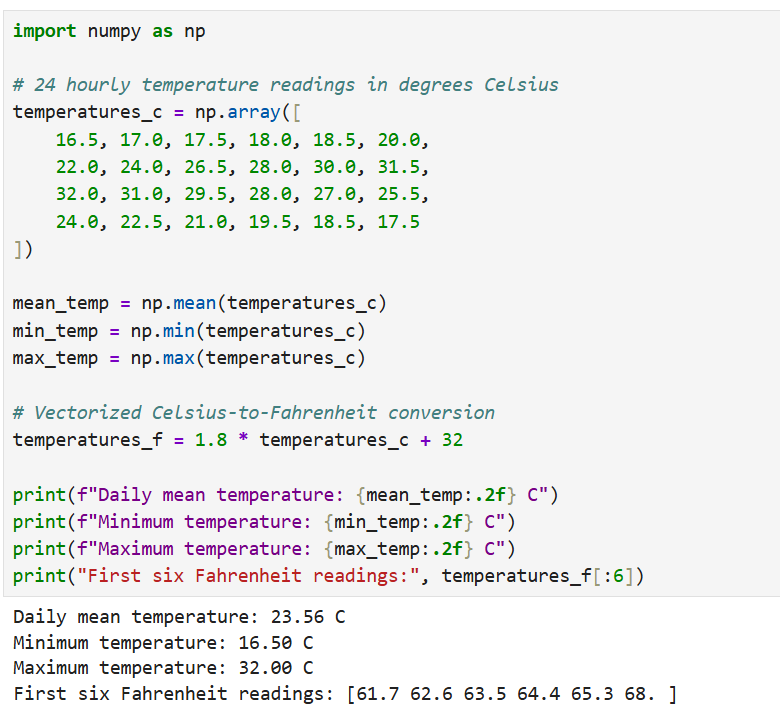
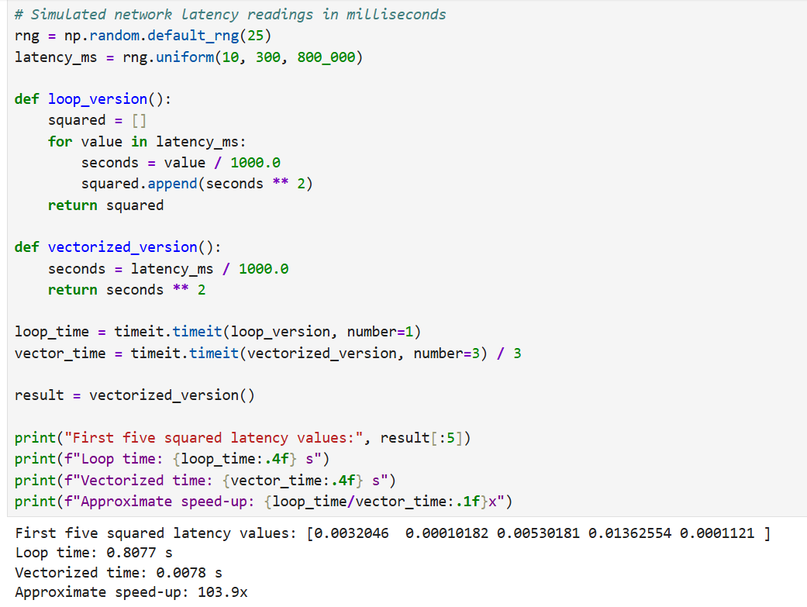
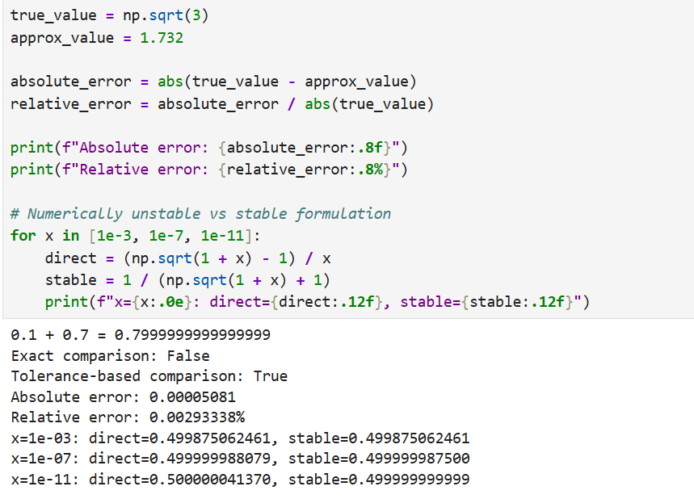

# BIT 2118 – SCIENTIFIC COMPUTING GROUP WORK

## 1. Project Overview

This repository contains the practical programming assignments for BIT 2118 – Scientific Computing. It consists of nineteen tasks, labelled A to S, implemented using Python and scientific computing libraries.

The project demonstrates the application of computational techniques, numerical methods, mathematical operations, data analysis and visualization to solve scientific and mathematical problems.

## 2. Project Objectives

The objectives of this project are to:

- Apply Python programming to scientific and mathematical problems.
- Practise numerical and computational methods.
- Use scientific computing libraries to perform mathematical operations.
- Explore numerical solutions to different computational problems.
- Generate and interpret computational results and graphical representations.
- Develop practical skills in using Jupyter Notebook.

## 3. Technologies Used

The project uses the following technologies:

| Technology | Purpose |
|---|---|
| Python | Main programming language |
| Jupyter Notebook | Writing and executing Python programs |
| NumPy | Numerical operations and array manipulation |
| SciPy | Scientific and numerical computations |
| Matplotlib | Data visualization and plotting |

## 4. Repository Structure

```text
BIT2118-Scientific-Computing/
│
├── notebooks/          # Jupyter notebooks for Tasks A-S
├── screenshots/        # Screenshots of program outputs
├── documentation/      # Project documentation
├── README.md           # Main project documentation
├── requirements.txt    # Required Python libraries
└── .gitignore          # Files excluded from Git tracking
```

## 5. Tasks

The project contains nineteen practical tasks:

- Task A: NumPy arrays and numerical operations
- Task B: Vectorization and computational operations
- Task C: Floating-point representation and numerical errors
- Task D: Matrix operations and transformations
- Task E: Solving systems of linear equations
- Task F: LU decomposition
- Task G: Iterative numerical methods
- Task H: Eigenvalues and eigenvectors
- Task I: Bisection and fixed-point methods
- Task J: Newton-Raphson and secant methods
- Task K: Nonlinear equations
- Task L: Interpolation
- Task M: Curve fitting
- Task N: Numerical differentiation
- Task O: Numerical integration
- Task P: Euler's method for ordinary differential equations
- Task Q: Numerical solution of ordinary differential equations using SciPy
- Task R: Optimization
- Task S: Monte Carlo simulation

## 6. Installation and Setup

### Prerequisites

- Python installed on the computer.
- Jupyter Notebook installed.
- Git installed for repository management.

### Clone the Repository

```bash
git clone https://github.com/joshuaksamuel/BIT2118-Scientific-Computing.git
```

Navigate into the project directory:

```bash
cd BIT2118-Scientific-Computing
```

### Install Dependencies

Install the required Python libraries:

```bash
pip install -r requirements.txt
```

### Launch Jupyter Notebook

```bash
jupyter notebook
```

Open the `notebooks` directory and select the task you want to execute.

## 7. Execution Instructions

Each task is provided in a separate Jupyter Notebook.

To execute a task:

1. Open its corresponding notebook.
2. Run the cells sequentially.
3. Observe the generated numerical results.
4. Examine the graphs and visualizations where applicable.

The notebooks contain the program code and saved execution outputs.

## 8. Screenshots and Results

The `screenshots` directory contains visual evidence of the execution results for Tasks A to S.

Each task has its own screenshot folder to make it easier to locate and review the corresponding outputs.

The screenshot gallery is available in:

`documentation/Screenshot_Gallery.md`

## 9. Documentation

Additional project documentation is provided in the `documentation` directory:

- `Project_Overview.md`: General information about the project.
- `Task_Descriptions.md`: Brief descriptions of the individual tasks.
- `Input_Changes.md`: Explanation of the changes made to input values.
- `Screenshot_Gallery.md`: Organized screenshots of the task outputs.

## 10. Project Notes

The practical programs retain their original computational logic, algorithms, functions and mathematical methods. Input values were modified for the group work while preserving the original program structure and intended computational approaches.

## 11. Academic Information

Course Code: BIT 2118

Course Title: Scientific Computing

Project: Scientific Computing Group Work

Tasks Covered: A–S


## 10. Sample Program Outputs

### Task A – Output


### Task B – Output


### Task C – Output



